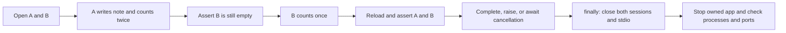

# LangGraph + e2e MCP: two isolated browser sessions

A runnable community example: a compiled Python LangGraph controls two
logical clients, A and B, against a synthetic service desk in real Chromium.
A saves a synthetic note and counts two requests. B counts one request and
must never see A's note or counter. No LLM, API key, account, or paid service
is needed.

Both logical clients share **one official Python MCP `Client` and one stdio
server process**. They own distinct e2e sessions, not independent protocol
connections. Sharing a server makes a wrong or omitted session ID observable.
Every `tools`, `call`, and `close_session` carries its actor's ID, except the
intentional negative test that proves an omitted ID returns `SESSION_REQUIRED`.

## Run

Requirements: Node.js 24+, npm, [uv](https://docs.astral.sh/uv/), and a machine
where Playwright Chromium runs. Python 3.12 is selected by `.python-version`;
uv can install it. Copy this directory to an independent repository or work
in it directly. It imports no monorepo modules and uses published, built npm
packages with pinned versions and integrity-checked locks.

```sh
npm ci --ignore-scripts
uv sync --frozen
uv run --frozen python demo.py
npm test
```

The web engine installs its pinned Chromium if missing on the first session.
That first run needs network access for the browser download. Dependency
installation also needs public npm/PyPI access. Later runs use only loopback
HTTP and local stdio. The child e2e process disables usage telemetry, and
the Python entry disables LangSmith tracing.

Select a scenario or an output directory:

```sh
uv run --frozen python demo.py --scenario normal --output artifacts/manual
uv run --frozen python demo.py --scenario exception
uv run --frozen python demo.py --scenario cancel
```

Each expected scenario exits zero after its own assertions and cleanup pass.
An unexpected error or a leftover owned process/port exits nonzero. The
exception scenario catches only `DeliberateFailure`; cancellation must reach
the in-flight MCP assertion before the graph task is cancelled.

## State and routing



`State.sessions` maps actor names to the IDs parsed from `open_session`'s
public text response. The graph state holds serializable data; the live MCP
client and cleanup ledger stay in the surrounding `Scenario`. The cleanup
ledger updates immediately after each successful open, before the graph node
returns, so a later failure still closes every known session. Nodes run in
sequence to make the A-before-B isolation check reproducible. Both browser
sessions stay open together throughout the graph.

`Scenario.call(state, "B", ...)` sends:

```json
{
  "name": "call",
  "arguments": {
    "session": "<state.sessions.B>",
    "tool": "run_code",
    "args": { "code": "await screen.getByRole('button', {name: 'Count request', exact: true}).click();" }
  }
}
```

The JSON above is the `tools/call` name/arguments payload, not a new tool in
core. `run_code` uses e2e's parsed test-statement grammar. It does not execute
arbitrary JavaScript. All assertions and screenshots come from public tools.

## What is proved

- Before B acts, its note and request count are empty despite A's changes.
- After reloading at the **same origin**, A still has its note and count 2;
  B still has no note and count 1. This exercises isolated localStorage and
  browser state in both directions.
- The exception happens after both isolation checks. Cancellation happens
  during a real MCP assertion waiting for text that never appears, with a
  30-second deadline. After cancellation, B's assertion still succeeds.
- `finally` attempts to close both IDs even if one close fails. Each closed
  ID is probed and must return `NO_SESSION`. Then the official SDK exits its
  stdio context, and the runner stops only the app process it started.
- Each run records child process identities and their observed TCP listener
  ports, then checks that those processes are gone and those ports refuse
  loopback connections. Chromium uses pipes; a browser need not expose TCP.
  No global process name matching or unrelated process termination is used.
- The regression suite intentionally misroutes B to A. Its isolation
  assertion must fail, and both original sessions must still close.

`artifacts/<scenario>/receipt.json` records every public MCP call, response
text, session ID, observed PID/listener, cancellation, and cleanup result.
`screen-*.png` files are MCP screenshots of each browser after reloading;
`mcp.stderr.log` captures server diagnostics. The regression suite writes
under `artifacts/tests/`; set `EXAMPLE_TEST_OUTPUT` to change that path.
Generated artifacts, environments and dependencies are ignored by Git.

## Limits and publication

This proves local orchestration, browser isolation and cleanup for these
three scenarios. It does not prove a remote service persists or cleans up
a session after stdio closes, remote reconnection, host crashes, mobile
isolation, or an LLM's behavior. The TCP check is a final point-in-time
check of observed owned listeners, not an audit of the host. The demo
cancels the graph task during a tool call, not during session acquisition.
There are two logical session clients and one protocol connection.

`registry-entry.draft.json` is a publication draft, deliberately absent from
the live e2e registry. Replace its repository placeholder with a real public
GitHub/GitLab URL pinned to a full reviewed commit SHA before submitting it.
Do not treat the draft as an accepted upstream contribution. The folder has
its own Apache-2.0 license and can be extracted without the e2e monorepo.

Last checked: 2026-11-13, macOS, Node 24.22.2, Python 3.12,
e2e 0.23.1, @e2e-dev/web 0.16.0, LangGraph 1.2.21, MCP Python SDK 2.3.0.

References: [LangGraph compilation](https://reference.langchain.com/python/langgraph/graph/state/StateGraph/compile),
[official MCP Python stdio transport](https://py.sdk.modelcontextprotocol.io/client/transports/#stdio),
[e2e MCP sessions](https://e2e.com/docs/reference/mcp#several-sessions),
[community example requirements](https://github.com/e2e-inc/e2e/blob/main/examples/CONTRIBUTING.md).
